<p align="center"></p>

# CopperPilot Tablet

**A compact 8.4-inch Android-class tablet around a chip-down Rockchip RK3566 with 4 GB LPDDR4X and 64 GB eMMC on an 8-layer, 0.8 mm mainboard strip, a 1600 x 2560 dual-DSI display, front and rear cameras with flash, stereo speakers, a 21 Wh battery and USB-C on its own daughter board, in a CNC aluminium shell. Designed end to end by CopperPilot from three photos and a prompt.**

[](https://copperpilot.ai)  [](reviews/gates.md) [](reviews/kicad) [](reviews)  [](LICENSE)

> [!NOTE]
> **Designed by [CopperPilot](https://copperpilot.ai).** CopperPilot's agents designed every board, schematic, layout and enclosure part in this repo from one prompt and a few reference photos, then checked them with the gates and reviews below. Nobody edited the design files by hand. The prompt asked for a compact 8-inch-class tablet like the one in three photos (front, back and a teardown), set the display, the shell and a rough spec for the mainboard (SoC, memory, stack-up, impedance targets, placement along the strip), and after the first build the owner gave measured rear details (corner radius, camera ring, microphone and flash positions). The agents chose the parts, drew and routed both boards, modelled the shell and fixed every review finding themselves. **It has not been fabricated, assembled or powered on yet.** Everything here is open for review: if you see something a senior engineer would flag, [open an issue](../../issues/new/choose).

A 134 x 198 x 9.4 mm tablet with 14 mm corners and a flat CNC aluminium back:
- **Front:** a Sharp LQ084R1SX01 8.4-inch 1600 x 2560 oxide TFT (dual-channel MIPI-DSI, 2 x 4 lanes) under a cover
  glass with a bonded capacitive touch sensor.
- **Mainboard:** a 28 x 125 mm, 8-layer, 0.8 mm strip along one long edge under the display, with solder-down
  shields over the SoC/RAM and the PMIC; the battery fills the rest of the interior.
- **USB-C daughter board:** 25 x 12 mm, centred on the bottom edge, joined to the mainboard by a 16-pin FPC.
- **Back:** one raised camera ring, a rear microphone hole and a flash window on one line in the top corner; the
  Wi-Fi antenna sees out through a plastic insert in the top edge wall.

## Status

### Done

- [x] Schematic: KiCad ERC, 0 errors
- [x] Layout: KiCad DRC with schematic parity and zone refill, 0 errors, 0 unconnected
- [x] Board rules no looser than the fab's limits, nothing silenced
- [x] Every part on the footprint and 3D model of its exact LCSC part
- [x] Every placed part has a live, in-stock LCSC/JLCPCB part number
- [x] High-speed groups (USB, MIPI, DDR where present) routed, length-matched, on target impedance
- [x] Every user-facing connector opens towards its case opening (checked on its 3D model)
- [x] Every connector mates from a known side, with a keep-clear zone KiCad DRC enforces
- [x] Both ends of every board-to-board cable carry the same signal on each wire
- [x] Datasheet-level design review: 0 P0 and 0 P1 findings open on every board
- [x] Enclosure parts are closed solids that fit the product envelope
- [x] Every enclosure part is manufacturable by its process (wall thickness, build size)
- [x] Full assembly with the real PCBAs: no collisions, seated or along any insertion path
- [x] Every cable joins two real connectors and fits its route in every pose
- [x] Every connector faces what mates with it; every screw hole sits on a boss
- [x] Every port opening has its connector right behind it
- [x] Every button and control physically reaches the switch it works
- [x] Every camera's whole field of view clears the case
- [x] Every part is held by something real (screw, snap, clip, adhesive, press fit)
- [x] Gerbers, drill, BOM and CPL exist and agree with the PCB
- [x] Independent judge (compares renders to the reference photos): **9/10** ([notes](reviews/judge.md))

### Pending

- [ ] Gate `sourcing.bom` warn: 77 extended parts (each adds a JLCPCB feeder fee); prefer basic parts where equivalent
- [ ] Gate `kicad.drc` warn: [main] DRC warning lib_footprint_mismatch x199
- [ ] Gate `board.contract` warn: [main] U2 rotation 0.0 != spec 90.0
- [ ] **Not built.** Neither board has been fabricated or assembled and no shell has been machined.
- [ ] **No software bring-up.** No device tree, kernel or Android image exists for this board; the dual-DSI panel, both cameras, Wi-Fi/Bluetooth, the charger and audio are untested.
- [ ] **Display bandwidth risk.** 1600 x 2560 is about 11% above the RK3566's listed dual-DSI limit (2560 x 1440 at 60 Hz), so the panel may need a reduced refresh rate (50-54 Hz); the RK3576 is the upgrade path.
- [ ] **Display FPC pinout modelled from a sibling.** The 40-pin panel connector follows the closest Sharp dual-DSI sibling (LQ101R1SX01); it must be checked against the LQ084R1SX01's own datasheet before fabrication.
- [ ] **Touch controller comes with the sensor.** The touch sensor is a chip-on-flex part whose controller sits on its flex (I2C + INT + RST through the 10-pin FPC); the exact sensor and controller still have to be chosen. The MPR121 on the board is a grip/proximity sensor, not the touchscreen controller.
- [ ] **Bought parts are specified from drawings.** The battery, both camera modules, the speakers and the button flex are modelled from typical drawings; exact suppliers still have to be chosen and checked against those models.
- [ ] **Judge notes (9/10):** 9.4 mm thick against about 6.3 mm for the reference (set by the 3.2 mm panel and the battery stack, as the prompt asked); the reference's side stylus-charging strip is left out.
- [ ] **DRC warnings:** 343 on the mainboard, mostly footprints that differ from their library copy (199), co-located holes (95) and hole-to-hole spacing (15); 0 errors. The RAM's placed rotation differs from the spec's (0 vs 90 degrees).
- [ ] **Thermal design not analysed.** The SoC shield is tied to a graphite sheet on the aluminium back through a thermal pad; no thermal simulation was run.

0 P0 · 0 P1 · 0 P2 review findings open; the full reviews with evidence and suggested fixes are in [reviews/](reviews). Every P0 and P1 the reviews raised was fixed before release.

## Build film

[docs/build-film.mp4](docs/build-film.mp4) (48 s, 720p). Every part moves in the assembly order and along the insertion path that the collision gates checked, and every cable is drawn along its real route.

## Renders

| | |
|:---:|:---:|
| 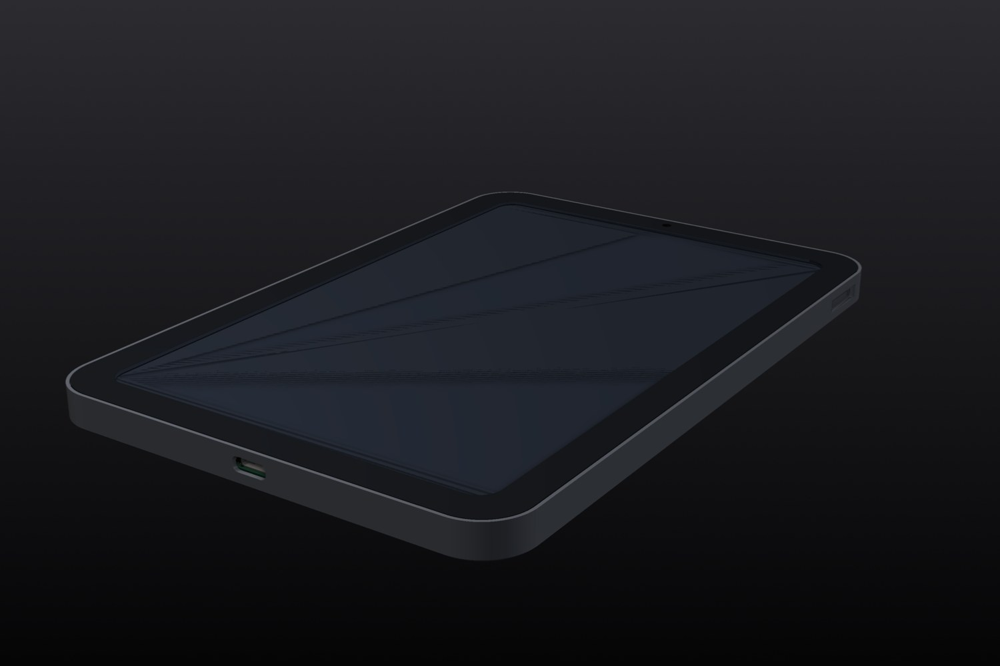<br>*Three-quarter view* | 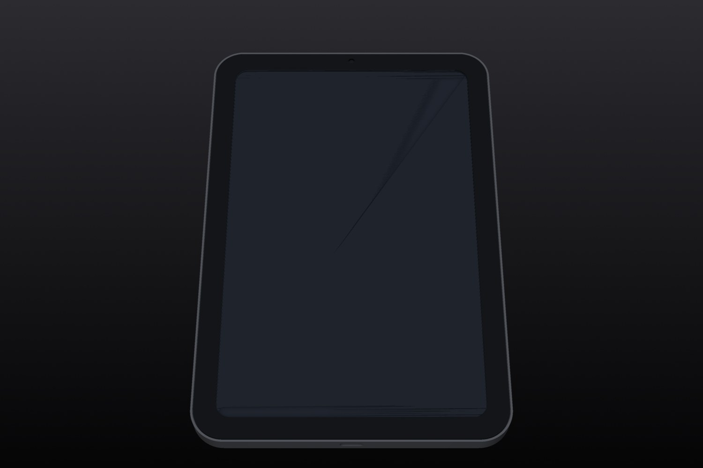<br>*Front* |
| 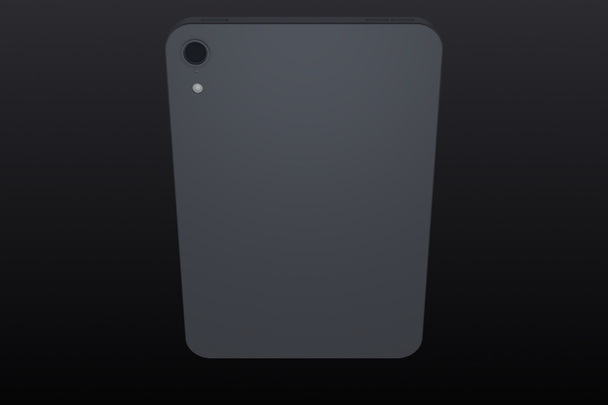<br>*Rear* | 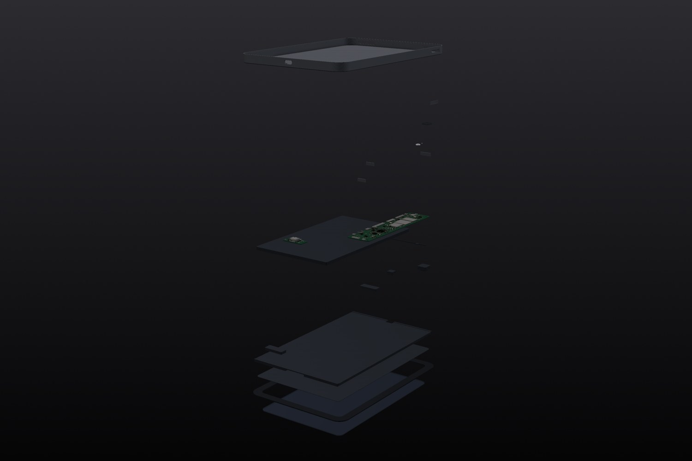<br>*Exploded* |
| 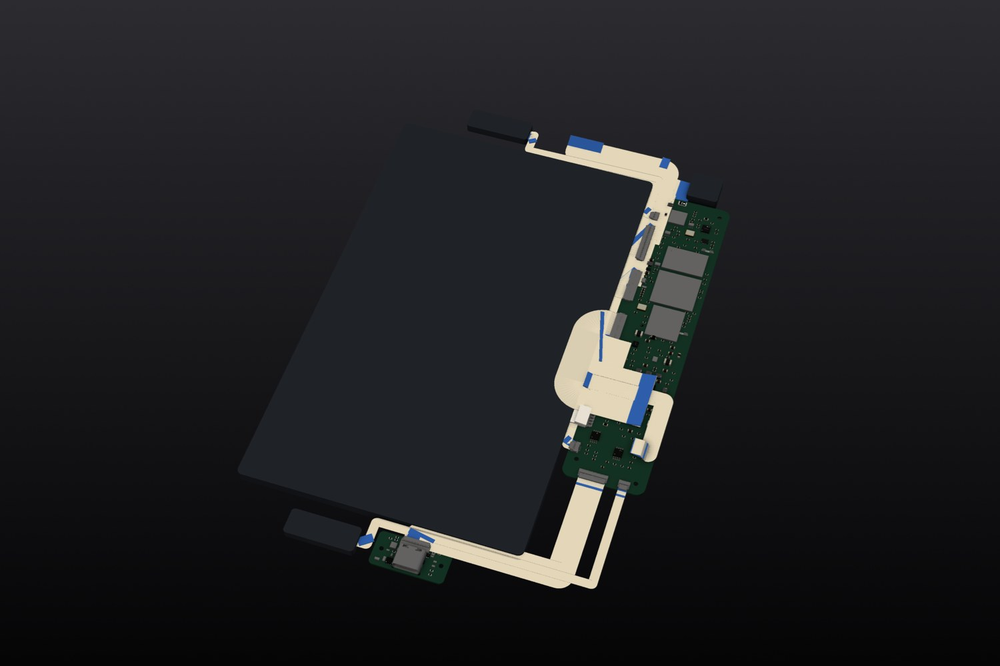<br>*Inside, top cover lifted away, every cable* | 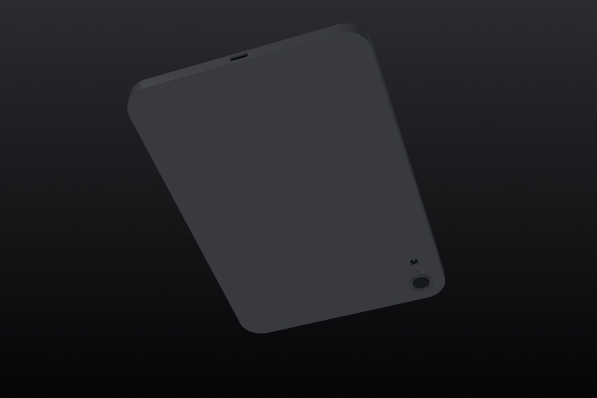<br>*Inside from below, bottom cover lifted away* |
| 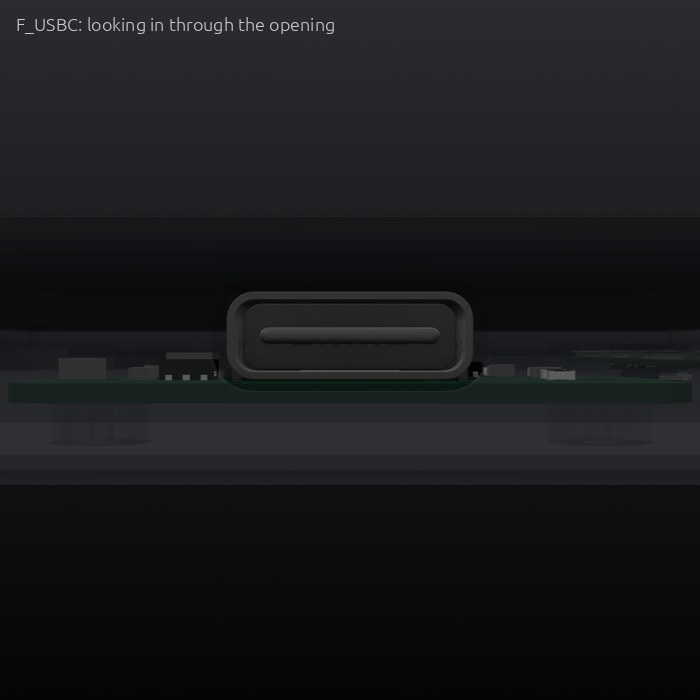<br>*Ports* | 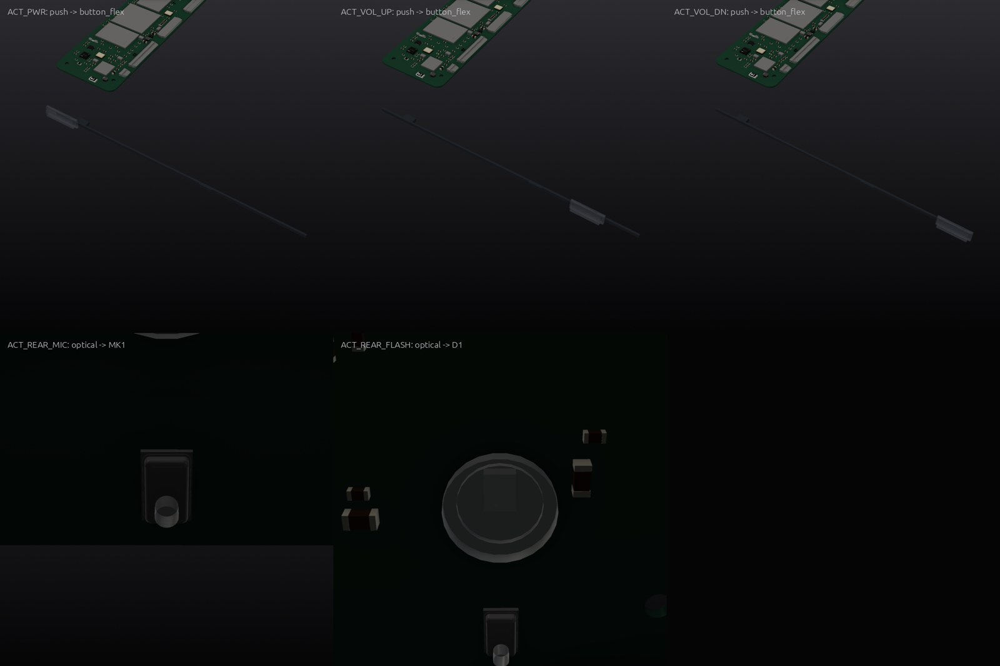<br>*Buttons and controls, next to the parts they press* |

## What's inside

**Compute:** Rockchip RK3566 (chip-down) with 4 GB LPDDR4X x32 (K4FBE3D4HM) within 15 mm and 64 GB eMMC 5.1; RK809-5
PMIC for the SoC rails, with VDD_CPU on its own RK860 buck. High-speed groups (every DDR byte lane, the CA group, DSI0,
DSI1, camera CSI and USB 2.0) are declared with impedance targets and length tolerances and checked by the gates.
**Power:** BQ25895 1S charger for a 21.28 Wh (5600 mAh) pouch with NTC and protection board; 5 V / 3 A USB-C sink
with 5.1 kOhm CC pull-downs, surge and ESD protection on the daughter board.
**Peripherals:** RTL8723DS Wi-Fi/Bluetooth on SDIO with a chip antenna at the RF window; TPS61165 WLED boost for the
panel backlight; 8 MP rear and 5 MP front MIPI-CSI cameras; AW3641E flash driver; two NS4150B class-D amplifiers for
the top and bottom speakers; MEMS microphone; button flex for power and volume.

| Board | Size | Layers | Parts | Tracks | Vias | KiCad project | Review |
|---|---|---|---|---|---|---|---|
| Main board | 28 × 125 mm | 8 | 431 | 90,618 | 1,703 | [`hardware/compact-tablet.kicad_pro`](hardware/compact-tablet.kicad_pro) | [0 P0 · 0 P1](reviews/review-main.md) |
| USB-C daughter board | 25 × 12 mm | 2 | 26 | 150 | 40 | [`hardware/usbc_board/compact-tablet-usbc_board.kicad_pro`](hardware/usbc_board/compact-tablet-usbc_board.kicad_pro) | [0 P0 · 0 P1](reviews/review-usbc_board.md) |

**Bought parts** (modelled from their drawings; the assembly checks use these models):

- **Display panel**: Sharp LQ084R1SX01 8.4-inch 1600x2560 WQXGA oxide TFT LCD module with dual-channel MIPI-DSI and WLED backlight
- **Touch sensor**: Optically bonded 8.4-inch COF
- **Battery**: 1S 3.8V 5600mAh
- **Rear camera**: 8 MP autofocus MIPI-CSI rear camera module with 30-pin 0.5 mm FPC tail
- **Front camera**: 5 MP fixed-focus MIPI-CSI front camera module with 24-pin 0.5 mm FPC tail
- **Top speaker**: Top landscape-stereo micro-speaker enclosure module
- **Bottom speaker**: Bottom landscape-stereo micro-speaker enclosure module
- **Button flex**: Top power button and volume up/down metal-dome switch flex cable assembly

## How it was made

CopperPilot's agents worked from the prompt in [reference/prompt.md](reference/prompt.md) and 3 reference photos ([reference/](reference)). The pipeline scopes the product into a written contract ([design/spec.yaml](design/spec.yaml)), designs the boards and the enclosure in parallel, integrates them, and only moves on when the gates pass. A separate review agent reads every board against the part datasheets, and a separate judge compares the result with the photos.

- Pipeline wall clock: about **89 h** over 11 launches (pipeline v71 to v119).

**Reference vs build:**

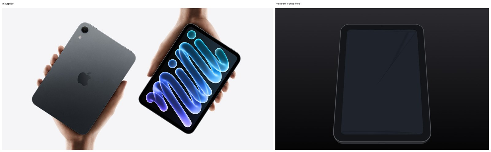
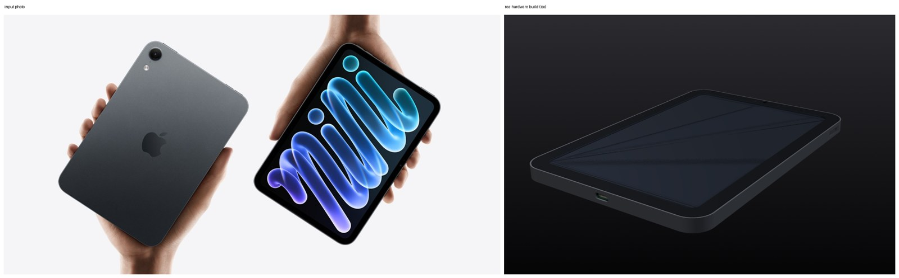
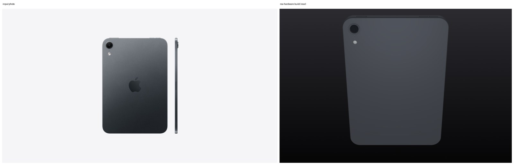

<sub>Reference photos of a commercial product, used here only for comparison. All rights belong to their owners; this project is not affiliated with or endorsed by the product's maker.</sub>

## Repository layout

```
hardware/          KiCad 10 projects (main board at the top, daughter boards in their own folders)
  lcsc.*, rea_refs.*   symbols, footprints and 3D models for every part, so the project opens anywhere
case/out/          enclosure parts (STL)
case/purchased/    bought parts used in the assembly checks
case/generate_case.py  the parametric enclosure source (uses CopperPilot's CAD helpers, not yet public)
fab/               Gerbers, drill, BOM, CPL, schematic PDF and STEP for each board; fab/mech/ enclosure STEP/STL
design/spec.yaml   the design contract the agents wrote and the gates check
reviews/           gate report, design reviews, the judge's notes, KiCad ERC/DRC
reference/         the prompt and the reference photos
docs/              build film and renders
```

## Manufacture

Every board targets **JLCPCB** standard PCB + assembly (0.8 mm FR-4); every part has an LCSC number. Per board: upload `*-gerbers.zip`, then `*-bom.csv` and `*-cpl.csv` for assembly, and check the part rotations in JLCPCB's preview before ordering.

The back shell, buttons and bezel are designed for CNC (6061 aluminium, PC/ABS for the bezel and the RF window), the
flash window for SLA; STEP files for each part are in `fab/mech/`, with STLs for test prints. Both boards are set up
for JLCPCB fabrication and assembly (Gerbers, BOM and CPL per board); the mainboard uses JLCPCB's 8-layer 0.8 mm
process with via-in-pad and impedance control.

> [!WARNING]
> This design has not been built yet. Fix or accept the open review findings above before you order boards, and expect a first revision to need changes.

## Review this design

Hardware gets better with more eyes on it. We'd like to hear what you'd flag:

- **Open an issue** ([design review template](../../issues/new/choose)) for a wrong pin, a missing part, a tight clearance, a part you'd swap, or a P1 above you disagree with.
- **Send a pull request** with a fix. Say which board and which reference designators it touches.
- **Build one** and tell us how it went: photos, bring-up notes and failures are all welcome.

Start with [reviews/](reviews): every finding has its evidence and a suggested fix.

## License

[CERN-OHL-S-2.0](LICENSE). You may use, study, modify, make and sell products from this design; modified versions must be shared under the same licence.

Part and product names are used only to say what fits; all trademarks belong to their owners.

<p align="center"><a href="https://copperpilot.ai"><b>Designed by CopperPilot</b></a>: we accelerate hardware design.<br><sub>More open designs: <a href="https://github.com/CopperPilot">github.com/CopperPilot</a></sub></p>
